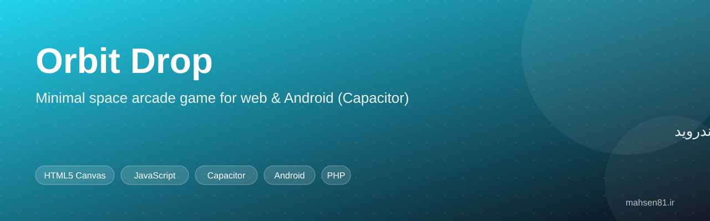
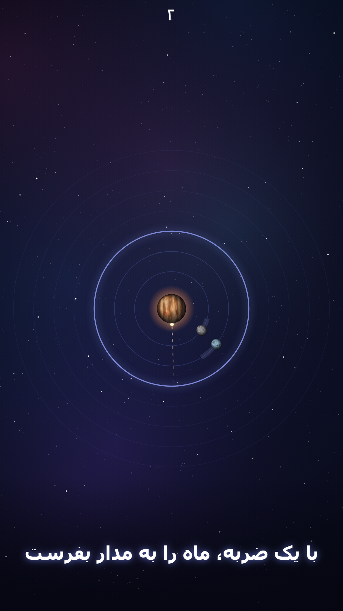
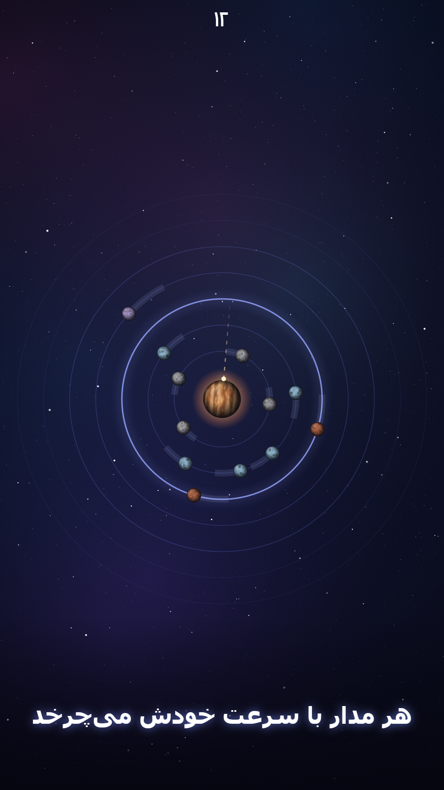
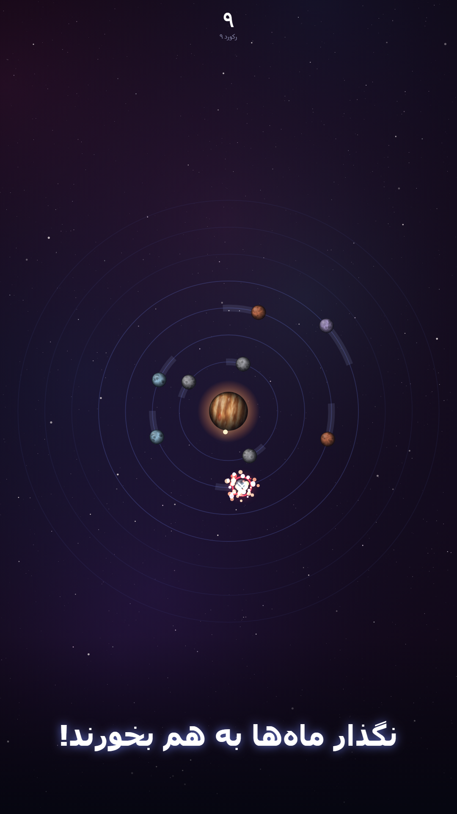

<!-- gen:header -->
<p align="center"></p>

<h1 align="center">Orbit Drop</h1>
<p align="center"><b>بازی آرکید فضایی برای وب و اندروید</b><br><i>Minimal space arcade game for web & Android (Capacitor)</i></p>
<p align="center">    </p>

<div dir="rtl">

## ✨ امکانات

- گیم‌پلی سریع یک‌انگشتی
- نسخه‌ی وب و اپ اندروید از یک کد
- سرور امتیازات با PHP
- تصاویر آماده‌ی فروشگاه

</div>

## 📸 تصاویر · Screenshots

<p align="center">   </p>

## 🚀 Quick start

```bash
Open orbit-drop/index.html — or: cd orbit-drop-android && npm i && npx cap sync && npx cap open android
```

---

<p align="center">ساخته‌شده توسط <a href="https://mahsen81.ir"><b>محسن جباره‌اصل</b></a> — برنامه‌نویسی، طراحی سایت، ربات و هوش مصنوعی<br>
Built by <a href="https://mahsen81.ir">Mohsen Jabbareh-Asl</a> · ⭐ اگر مفید بود، ستاره بدهید · Need a custom version? <a href="https://mahsen81.ir">Get in touch</a></p>
